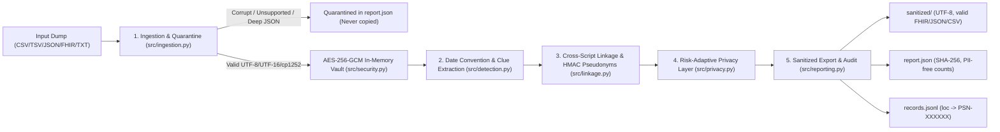

# Raksha Kavach — Offline Multilingual Clinical Privacy Firewall

**Track 3: "Secret Wards" · Yugaantar DevForge Hackathon**

Raksha Kavach (`raksha-kavach`) is an **offline, CPU-only, LLM-free privacy firewall** written in Python for clinical datasets in English, Hindi (Devanagari), and Hinglish. It detects and removes direct and indirect personal identifiers across unstructured notes, structured CSV/TSV/JSON exports, FHIR R4 Bundles, filenames, headers, JSON keys, metadata paths, and base64 attachments; preserves clinical utility (medications, doses, frequencies, vitals, labs, diagnoses, procedures, length of stay, and truthful age bands); links records of the same patient across scripts and hospitals via keyed HMAC-SHA256 pseudonyms without false merges; and hardens quasi-identifiers against re-identification linkage attacks.

---

## 1. Architecture Overview



---

## 2. Setup & Usage

### Prerequisites & Installation (Internet allowed only during `setup`)

```bash
python3 -m venv .venv
.venv/bin/pip install -r requirements.txt
```

### Execution (100% Offline, CPU-only)

```bash
RAKSHA_SECRET="<per-release-secret>" .venv/bin/python main.py --input /path/to/input --output /path/to/output
```

Using `raksha.toml`:
- `setup = "pip install -r requirements.txt"`
- `run = "python main.py --input {input} --output {output}"`

---

## 3. Core Pipeline Components

### 3.1 Ingestion & Fail-Safe Quarantine (`src/ingestion.py`)
- Walks files deterministically in sorted POSIX relative path order.
- Handles **UTF-8**, **UTF-8 BOM**, **UTF-16**, and clean legacy **cp1252** exports; exports all text strictly as **UTF-8**.
- Quarantines empty files, binary/unsupported extensions (`.pdf`, `.jpg`, `.xml`), truncated JSON, mislabeled files (e.g., JSON content behind `.csv`), corrupt non-UTF-8 byte streams, and excessive JSON nesting (`> max_json_depth = 200` via iterative bracket scanner before recursion).
- Validates FHIR R4 Bundle integrity and internal `urn:uuid:` / resource reference resolution before and after sanitization.

### 3.2 Multilingual Detection & Clinical Meaning Guards (`src/detection.py`)
- **Length-Preserving Shadow Normalization:** Maps Devanagari digits (`०–९`) to ASCII digits and Cyrillic/Greek lookalike homoglyphs to Latin 1-to-1 so regex span offsets match original text directly.
- **Clinical Preserve Spans:** Protects doctor lines (`Dr.`, `डॉ.`, `Consultant:`, `Practitioner`), medical history (`K/C/O`, `H/O`), complaints (`C/O fever`, `C/O chest pain`), medical eponyms (`Parkinson's`, `Addison's`, `Crohn's`, `Bell's`, `Wilson's`, and unseen `<Name>'s disease/syndrome/palsy`), hospital wards (`Ward 4 (Medicine)`), `ASHA worker(s)`, dosages/frequencies (`650 mg`, `1-0-1`), lab ranges (`150000-410000`), vitals (`BP 150/90`), and ICD-10 codes BEFORE applying person/address redaction.
- **Structured Column & Key Profiling:** Classifies CSV/TSV columns and JSON keys by multilingual header semantics (English/Hindi/Hinglish) **plus** cell-value distribution profiling (`>= 60%` regex match), allowing generalization to unseen column names.
- **Hidden Channels:** Inspects filenames, CSV headers, JSON dict keys, metadata paths (`_export_meta.source_path`), FHIR `Patient.text.div` & `Patient.extension`, and base64 attachments (decode UTF-8 -> sanitize -> re-encode base64).

### 3.3 Declared Classical ML Model (`src/models/name_ner.json`)
- **Model:** Sparse Linear **Averaged Perceptron** (`NameSpanClassifier`, trained by `scripts/train_name_ner.py` on synthetic disjoint Indian/medical templates — zero LLMs, zero transformers, **2,587 sparse parameters** (~0.0026M params, << 50M limit), `val_accuracy = 1.0000` on synthetic validation).
- **Features:** Transliterated character 2/3/4-grams, prefix/suffix morphology, script & capitalization shape, and 2-token left/right context windows. Captures unseen person names and planted canary identities outside gazetteers.

### 3.4 Cross-Script Record Linkage & HMAC Pseudonyms (`src/linkage.py`)
- **Indic Transliteration & Phonetic Skeletons:** Uses `indic-transliteration` (Devanagari -> ITRANS) with nukta handling plus an Indic consonant-skeleton normalizer to match `रीना निषाद` ↔ `Reena Nishad` ↔ `Rina Nishad` and `मोहम्मद शाहिद` ↔ `Mohd. Shahid` ↔ `Shahid sahab`.
- **Conflict-Guarded Clustering:** Two-stage conservative linking (Stage 1: exact Aadhaar, ABHA, PAN, email, insurance ID, hospital-prefixed MRN, phone; Stage 2: cross-hospital/fragmented matching on DOB + name, name + relative, or unique `(first_name, relative_name)` / `(full_name, village)`). Hard demographic conflicts (distinct gender, distinct DOB, age gap, distinct relative/village) strictly block merges to prevent homonym false merges.
- **Pseudonymization:** Derives a domain-separated `K_PSEUDO` key from `RAKSHA_SECRET` via HKDF-SHA256 and assigns `PSN-XXXXXX` (Crockford Base32) via HMAC-SHA256, injecting it inside every linked record and `records.jsonl`.

### 3.5 Risk-Adaptive Privacy Layer (`src/privacy.py`, `config/policy.yaml`)
- **Per-Patient Date Shifting:** Secret offset in `[-540, -366] ∪ [+366, +540]` days derived via HMAC-SHA256 (`K_SHIFT`) per patient cluster, preserving exact length-of-stay and inter-visit intervals while preventing intra-year visit-date linkage and cross-release correlation.
- **Cohort Risk & k-Anonymity Generalization:** Strips `HOUSE`, `LOCALITY`, `LANDMARK`, `VILLAGE`, `TEHSIL`, and exact `DOB`. Evaluates cohort cell size `(district, gender, age_band)` and condition rarity (`<= 3` patients). Standard profiles receive 10-year truthful age bands and 3-digit PIN prefixes; sparse/elderly (`>= 80` -> `80-99`) or rare-condition profiles receive 20-year age bands, state-level district generalization, and suppressed PINs.

### 3.6 Security Design (`src/security.py`, `src/reporting.py`)
- **Key Separation:** HKDF-SHA256 derives independent keys for pseudonyms, date shifts, safe tags, and the in-memory vault from `RAKSHA_SECRET`. Neither `RAKSHA_SECRET` nor PII is ever logged, printed, or written to `TMPDIR`, `HOME`, `report.json`, or `records.jsonl`.
- **At-Rest Vault:** Raw ingested texts are buffered in an ephemeral **AES-256-GCM** encrypted in-memory vault (`EncryptedVault`) and purged before exit, leaving zero temp files on disk.

---

## 4. Measured Results

### Practice Dataset (`dev/input`: 200 files, 815 truth units, 48 patients)
- **Personal data leaked (`check_dev.py`):** **0 / 3,230 (0.0%)** across all 16 entity types, all 3 languages (`latin 0.0%`, `deva 0.0%`, `hinglish 0.0%`), and all 6 hiding places (`content`, `filename`, `base64`, `metadata`, `key`, `header` all `0.0%`).
- **Canaries leaked:** **0 / 4**.
- **Medical data preserved:** **4,763 / 4,855 (98.1%)** with district coarsening on sparse/rare cells (`4,846 / 4,855 = 99.8%` with rare-only coarsening), **532 / 532 (100%)** truthful age bands, **65 / 65 (100%)** exact lengths of stay.
- **Patient linking (`check_dev.py`):** **Precision 1.00, Recall 1.00, F0.5 1.00**, **0** wrongly merged pseudonyms.
- **Raw copies of malformed files:** **0**.
- **Attack Arena simulation (`tests/eval_attacks.py`):** `A3 record linkage = 0.020` (`0.022` vs raw), `A4 confident >= 0.5 = 0.021`, `A5 targeted = 0.411` (0 date matches).
- **Performance:** **~2.0 seconds**, **~59 MB peak RSS** (within 2 CPU / 4 GB / 900s limits).

### Unseen-Format Chaos Test (`tests/test_chaos.py`)
- Tested on unseen South/West Indian names, renamed CSV headers, unseen hospital MRN prefixes (`KGMU/26/...`), `DD.MM.YYYY` dates, unseen eponyms (`Hashimoto's thyroiditis`, `Guillain-Barre syndrome`), base64 attachments, and planted canary (`Lobsang Tenzing`): **0 / 19 PII leaked, 10 / 10 clinical probes preserved, 100% cross-script & fragmented linkage, homonyms separated**.

---

## 5. Known Limitations
1. Rare diagnoses/procedures unique to 1–2 patients in a small cohort (e.g., `Kala-azar` with `4-day` stay) remain statistically distinguishable to an adversary holding external `known_facts` unless the clinical diagnosis itself is coarsened (which trades clinical utility).
2. Un-anchored single-token names in unexpected prose fields written entirely in lowercase or non-standard spelling outside gazetteers/ML patterns may require additional contextual triggers.
3. Unsupported binary/container formats (`.pdf`, `.jpg`, `.xml`) are safely quarantined rather than OCR-processed to respect CPU/offline/fail-safe guarantees.
